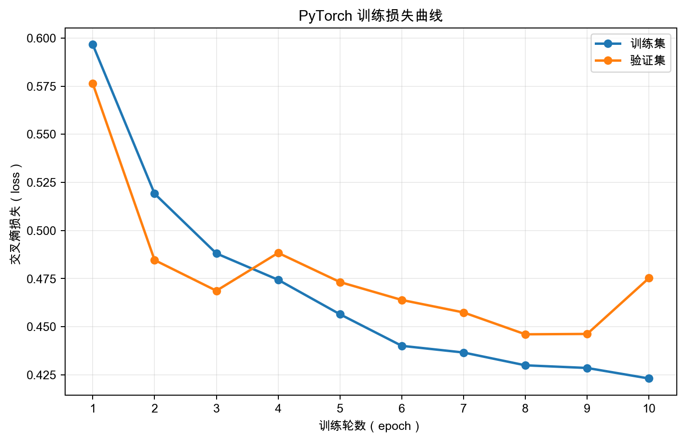

# 猫狗分类器

这是我学习卷积神经网络时做的猫狗分类项目：先用 NumPy 手写前向传播、反向传播和 SGD，再用 PyTorch 实现相同的两层卷积结构，比较训练过程并分析误判。

[项目概览](#项目概览) · [快速开始](#快速开始) · [使用说明](#使用说明) · [开发与验证](#开发与验证) · [目录结构](#目录结构) · [项目文档](#项目文档) · [当前边界](#当前边界)

## 项目概览

- **NumPy 手写版**：从卷积、池化到梯度更新，理解网络怎样学习。
- **PyTorch 版**：包含训练、测试、单图预测和误判可视化。
- **实验记录**：保留模型、指标、训练曲线与 Notebook，便于查看实现过程和结果。

两套代码都接收 `128 × 128` 的 RGB 图片，类别约定为猫 `0`、狗 `1`。结构与实验分析见 [设计与实验记录](docs/architecture.md)。

### 历史实验结果

| 实现 | 最佳验证准确率 | 测试准确率 | 记录 |
| --- | ---: | ---: | --- |
| NumPy 手写版 | 76.80% | 76.24% | [实验摘要](outputs/numpy_baseline/evaluation_summary.json) |
| PyTorch 版 | 80.58% | 80.48% | [实验记录](docs/architecture.md#实验结果)、[测试摘要](outputs/pytorch/evaluation_summary.json) |

这些是仓库保留的历史实验结果，测试集为 5,000 张图片。两版的优化器、归一化和数据增强不同，不能把差距简单归因于框架。依赖没有锁定完整版本，重新训练的结果可能不同。



曲线来自 2026 年 8 月 26 日的另一次训练，数据见 [training_history.json](outputs/pytorch/training_history.json)，不对应上表原始最佳模型的逐轮记录。误判原因、异常样本和改进方向见 [设计与实验记录](docs/architecture.md)。

## 快速开始

准备支持 PyTorch 的 Python 环境；PyTorch 脚本使用 Python 3.10 及以上的类型注解语法。以下命令均在仓库根目录执行，`python` 应指向你使用的 Python 环境（部分系统命令名为 `python3`）。

```bash
git clone https://github.com/QTSHI/cat-dog-classifier.git
cd cat-dog-classifier
python -m venv .venv
```

激活环境：Windows PowerShell 使用 `.\.venv\Scripts\Activate.ps1`；macOS / Linux 使用 `source .venv/bin/activate`。

```bash
python -m pip install -r implementations/pytorch/requirements.txt
python implementations/pytorch/predict.py "path/to/example.jpg" --device cpu
```

将图片路径换成自己的猫狗照片。仓库已包含 `outputs/pytorch/best_model_pytorch.pt`，单图预测不需要完整数据集。程序输出猫、狗的预测概率；它只在这两个类别间选择，不能判断图片是否真的包含猫或狗。

`--device` 支持 `auto`、`cpu`、`cuda`、`mps`，默认自动选择可用设备。CUDA 和 Apple MPS 需要对应硬件与运行环境。

## 使用说明

### 数据与训练

1. 从 [Kaggle Dogs vs. Cats](https://www.kaggle.com/datasets/princelv84/dogsvscats) 获取数据，按 [数据准备说明](data/README.md) 放置并预处理训练集、测试集。图片未提交到仓库。
2. 选择一套实现安装依赖，再运行训练与测试。两套实现都默认读取 `data/processed/`。

> [!NOTE]
> 训练会写入模型和实验产物。PyTorch 默认使用 `outputs/pytorch/`，会覆盖同名历史文件；建议用 `--output-dir outputs/local-run` 保存新实验，并在测试时用 `--model-path` 指向新模型。NumPy 版使用脚本中的固定输出路径，运行前请先备份已有本地结果。

PyTorch 版（10 轮、batch size 32 为脚本默认值）：

```bash
python implementations/pytorch/train.py --device auto --output-dir outputs/local-run
python implementations/pytorch/evaluate.py --device auto --model-path outputs/local-run/best_model_pytorch.pt
```

NumPy 手写版（先准备每类至少两张 `128 × 128` 训练图片，再执行冒烟测试）：

```bash
python -m pip install -r implementations/numpy_baseline/requirements.txt
python implementations/numpy_baseline/smoke_test.py
python implementations/numpy_baseline/train.py
python implementations/numpy_baseline/evaluate.py
```

NumPy 测试所需的 `best_model_numpy.npz` 没有提交，需先完成训练。参数、设备选项和可视化命令分别见 [NumPy 说明](implementations/numpy_baseline/README.md)、[PyTorch 说明](implementations/pytorch/README.md)；产物的来源与重建方式见 [输出文件说明](outputs/README.md)。

### Notebook

[cat_dog_classifier_workflow.ipynb](notebooks/cat_dog_classifier_workflow.ipynb) 包含数据样本、特征图、训练曲线、混淆矩阵、误判样本和卷积核可视化。按顺序运行需要本地数据；默认读取已有模型，不会自动重新训练。

```bash
python -m pip install -r implementations/pytorch/requirements.txt -r notebooks/requirements.txt
jupyter notebook notebooks/cat_dog_classifier_workflow.ipynb
```

详细环境说明见 [Notebook 说明](notebooks/README.md)。

## 开发与验证

无需数据的语法检查可在仓库根目录执行：

```bash
python -m compileall -q implementations
git diff --check
```

[轻量 CI](.github/workflows/check.yml) 同时解析已跟踪的 JSON 和 Notebook JSON。它不安装训练依赖，不加载模型，也不验证准确率。NumPy 冒烟测试及 PyTorch 少量样本试跑需要本地图片，具体命令与结果记录要求见 [贡献指南](CONTRIBUTING.md#开发与验证)。

## 目录结构

```text
implementations/
├── numpy_baseline/    NumPy 手写版
└── pytorch/           PyTorch 版
notebooks/             Notebook 学习记录
docs/                  结构和实验记录
data/                  本地数据集
outputs/               模型与测试结果
.github/               轻量检查与反馈模板
```

## 项目文档

| 文档 | 内容 |
| --- | --- |
| [设计与实验记录](docs/architecture.md) | 网络结构、参数选择、历史指标、误判分析与改进方向 |
| [数据准备](data/README.md) | 数据目录、训练集与测试集预处理 |
| [NumPy 说明](implementations/numpy_baseline/README.md) | 手写版模块、参数与运行步骤 |
| [PyTorch 说明](implementations/pytorch/README.md) | 设备选择、训练、预测与可视化 |
| [Notebook 说明](notebooks/README.md) | 依赖、运行环境与本地数据前提 |
| [输出文件说明](outputs/README.md) | 历史产物来源、生成方式与覆盖行为 |
| [贡献指南](CONTRIBUTING.md) | 开发验证、问题反馈与提交约定 |

## 当前边界

- 模型只在猫和狗两个类别间选择，不能判断图片是否包含动物；高置信度也不代表可靠。
- 数据集没有提交，完整训练、测试与 Notebook 样本展示需要自行准备图片。
- 仓库包含 PyTorch 模型；NumPy 模型需自行训练。实验脚本可能覆盖同名输出，请保留历史材料并将新实验放入独立目录。
- 展示的准确率来自历史实验。两套实现的训练配置存在差异，曲线也来自单独一次重跑；依赖未锁定完整版本，重新运行的结果可能不同。
- 当前自动检查覆盖文件语法与 JSON 解析；完整训练、模型表现和不同硬件上的运行需单独验证。
